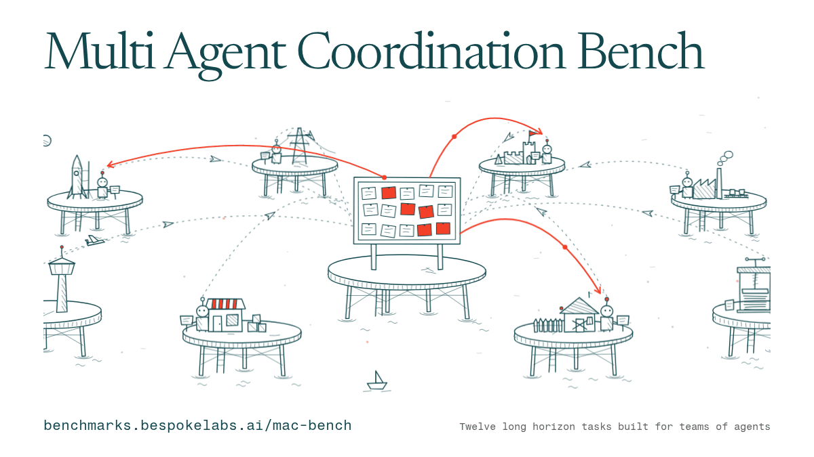

# Multi Agent Coordination Bench

This repository holds the tasks of [**Multi Agent Coordination Bench**](https://benchmarks.bespokelabs.ai/multi-agent-coordination-bench/)
(MAC Bench), a benchmark of twelve natively multi-agent, long-horizon tasks that measures how well teams of frontier
model agents coordinate.

<p align="center">
  
</p>

Each task is built so that the work of one agent depends on the work of its teammates. Every task runs in three
settings: a single agent, a team of k agents (2, 4 or 8) that coordinate over a shared message board, and k agents
without coordination. Comparing them separates the gain from adding more agents from the gain from coordination.
The [benchmark page](https://benchmarks.bespokelabs.ai/multi-agent-coordination-bench/) has the full report, the
leaderboard and the results for every task.

## Tasks

| Task | Domain | Type | Folder |
|---|---|---|---|
| Cave Rescue | emergency response | Shared | [`tasks/caverescue`](tasks/caverescue) |
| Mars Return | space mission design | Shared | [`tasks/mars-return`](tasks/mars-return) |
| Holdout-game | survival game | Distributed | [`tasks/holdout`](tasks/holdout) |
| 0 A.D. | game AI | Shared | [`tasks/legion`](tasks/legion) |
| Power Outage | power grid restoration | Distributed | [`tasks/power-outage`](tasks/power-outage) |
| Seed to Profit | company management | Shared | [`tasks/seed-to-profit`](tasks/seed-to-profit) |
| Mindustry | factory and defense game | Distributed | [`tasks/mindustry`](tasks/mindustry) |
| Dubai ATC | air traffic control | Shared | [`tasks/dxb-atc-live`](tasks/dxb-atc-live) |
| Chicago Skyline Survey | drone survey planning | Shared | [`tasks/chicago-skyline-survey`](tasks/chicago-skyline-survey) |
| Spectrum to Molecule | mass spectrometry | Shared | [`tasks/spectrum-to-molecule`](tasks/spectrum-to-molecule) |
| RNA Secondary Structure | computational biology | Shared | [`tasks/rna-secondary-structure`](tasks/rna-secondary-structure) |
| SOTA Compressor | algorithm engineering | Shared | [`tasks/compressor-sprint`](tasks/compressor-sprint) |

In a **shared** task all agents start with the same information and actions. In a **distributed** task the
environment gives each agent its own part of the system to see or control.

## Running a task

Each task is a [Harbor](https://github.com/harbor-framework/harbor) task folder. It runs with plain Harbor for a
single agent, and with [multi-agent-harness](harness/) for a team. The
README in each task's folder has the setup and the exact commands.

## License

The code written by Bespoke Labs in this repository, the tasks and [multi-agent-harness](harness/), is licensed under
the [Apache License 2.0](LICENSE). See [NOTICE](NOTICE).

Some tasks bundle or download third-party data and code, which keep their own licenses and are not covered by the
Apache License 2.0. Among them are GPL code (paq8px in SOTA Compressor; the Mindustry server that the Mindustry task
builds against), CC BY-SA files (the 0 A.D. Petra AI) and ODbL data (the OpenStreetMap-derived files in Dubai ATC and
Chicago Skyline Survey). Each task's `NOTICE.md` or the Credits section of its README lists its sources and their terms.

## Citation

```bibtex
@article{bespokelabs2026macbench,
  author  = {Shreyas Pimpalgaonkar and Kartik Sharma and Harsh Agarwal and Daniel Wang and Prajval Nakrani and Shivank Garg and Shahryar Adil Khan and Hardik Khichi and Anirudha Ramesh and Vishnu Suresh and Robert Zhang and Siddhant Jain and Alex Dimakis and Carlos Bonilla and Mahesh Sathiamoorthy},
  title   = {Multi Agent Coordination Bench},
  journal = {Bespoke Labs Blog},
  year    = {2026},
  note    = {https://benchmarks.bespokelabs.ai/multi-agent-coordination-bench/},
}
```
